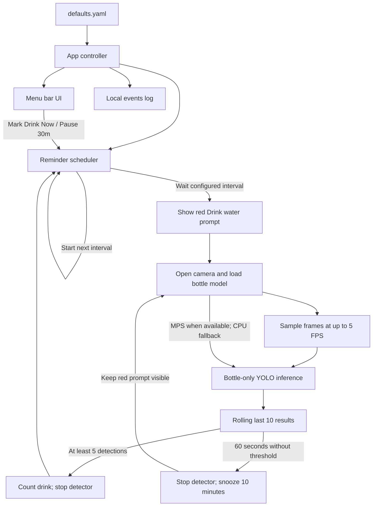

# JalLijiye

Hydration reminder app for macOS that runs in the menu bar and periodically prompts the user to drink water. During each reminder window, it runs only the custom bottle detector.

## Features

- Menu bar app with hydration count, manual drink confirmation, and a 30-minute manual pause.
- Waits for the configured reminder interval before opening the camera or loading the ML runtime.
- Shows a red `Drink water` prompt and runs the bottle model at 5 FPS for up to 60 seconds.
- Treats bottle detection in at least 5 of the last 10 sampled frames as a completed reminder, then waits for the regular interval.
- If the threshold is not met within 60 seconds, stops detection, keeps the red prompt visible, and retries after a 10-minute snooze.
- Prefers Apple MPS inference when available and falls back to CPU if MPS inference fails.

## High-Level Design

The app starts as a menu bar process. A scheduler thread waits for the configured interval before it opens the camera or loads the ML runtime. The default interval is 30 minutes.



### Runtime flow

1. The controller loads configuration, starts the menu bar, scheduler, and alert worker. The camera and ML dependencies remain unloaded while waiting.
2. At the configured interval, the scheduler enters a one-minute monitoring window. The menu bar shows **Drink water** in red; the detector opens the camera and loads only the custom bottle model.
3. The detector samples at up to 5 FPS. The scheduler keeps the latest 10 inference results; 5 or more bottle detections complete the reminder, increment the hydration count, and close the detector.
4. If the threshold is not reached within one minute, the detector closes and the app snoozes for 10 minutes. The red prompt stays visible while detection is off; another one-minute check starts after the snooze.
5. **Mark Drink Now** counts a manual drink and restarts the regular interval. **Pause 30m** postpones the next check by 30 minutes. **Quit** stops the detector and background workers.

While a monitoring window is active, the alert worker can play a sound every 30 seconds. It is silent during the normal wait and snooze. The menu bar also shows the hydration count, and runtime events are written to the local log. MPS is selected when available, with CPU fallback if MPS inference fails.

For the previous continuous person-and-bottle detection architecture, see the [legacy HLD](docs/legacy-hld.md).

## Setup

```bash
cd /Users/prateek/Downloads/_Projects/Personal/codex/jalLijiye
python3 -m venv .venv
source .venv/bin/activate
pip install --no-build-isolation -e '.[dev]'
```

## Run

```bash
cd /Users/prateek/Downloads/_Projects/Personal/codex/jalLijiye
source .venv/bin/activate
python -m app.main
```

Grant Camera permission when the first scheduled bottle check opens the camera.

## Build macOS App

Build a proper `.app` bundle for menu bar startup on macOS:

```bash
cd /Users/prateek/Downloads/_Projects/Personal/codex/jalLijiye
chmod +x scripts/build_macos_app.sh
./scripts/build_macos_app.sh
```

Expected output:
- `dist/JalLijiye.app`

## Config

Edit `/Users/prateek/Downloads/_Projects/Personal/codex/jalLijiye/config/defaults.yaml`.

Key values in `config/defaults.yaml`:

- `reminder_interval_minutes: 30.0`
- `detection_window_seconds: 60.0`
- `detection_snooze_minutes: 10.0`
- `fps: 5`
- `bottle_detection_window_frames: 10`
- `bottle_detection_threshold: 0.5`
- `bottle_model_path: models/bottle_v3/weights/best.pt`
- `bottle_class_id: 0`
- `bottle_confidence: 0.80`

## Fast Bottle Training Workflow

### 1) Collect videos

Put your webcam videos in:
- `data/raw_videos/`

### 2) Extract frames

```bash
source .venv/bin/activate
python scripts/extract_frames.py --input-dir data/raw_videos --output-dir data/bottle/images/raw --sample-every-seconds 1.0
```

### 3) Annotate

- Annotate only bottle boxes.
- Save YOLO `.txt` labels in `data/bottle/labels/raw/`.
- Class id mapping: `0 -> my_bottle`.

### 4) Split dataset

```bash
source .venv/bin/activate
python scripts/split_dataset.py --images-raw data/bottle/images/raw --labels-raw data/bottle/labels/raw --out-root data/bottle --train-ratio 0.8
```

### 5) Train + validate

```bash
bash scripts/train_bottle_model.sh
```

Expected output model:
- `models/bottle_v1/weights/best.pt`

## Tests

```bash
source .venv/bin/activate
pytest -q
```

## Launch at Login (Recommended)

Use the macOS autostart script.

Preferred flow:
- build `dist/JalLijiye.app`
- autostart launches the app bundle at login

Fallback flow:
- if the app bundle does not exist yet, the script falls back to the NoSlouchBench-style hidden Terminal runner

Install and start:

```bash
cd /Users/prateek/Downloads/_Projects/Personal/codex/jalLijiye
chmod +x scripts/autostart_macos.sh
./scripts/autostart_macos.sh install
```

Check status:

```bash
./scripts/autostart_macos.sh status
```

Stop:

```bash
./scripts/autostart_macos.sh stop
```

Uninstall:

```bash
./scripts/autostart_macos.sh uninstall
```

## Resource Optimizations

The Activity Monitor and isolated-model measurements below are historical observations from the previous continuous person-and-bottle detection flow. They are not measurements of the new scheduled bottle-only flow.

#### Scheduled bottle-only flow

Activity Monitor observations on 2026-10-20 for the scheduled bottle-only flow, with the reminder interval temporarily set to 30 seconds for testing (Python PID 73065):

| Configuration | CPU (% of one core) | GPU | Real memory | Measurement notes |
| --- | ---: | ---: | ---: | --- |
| 30-second reminder interval, 5 FPS bottle checks | 3.7–15.0% | 0–5.2% | 62.6–319.2 MB | Seven point-in-time samples over approximately 2.5 minutes; resource use varied as checks started and stopped. These are observed ranges, not averages or process high-water marks. |

The interval was restored to the normal 30-minute default after the test. Activity Monitor's GPU percentage was 0% in four samples and reached 5.2% in one sample; the other two samples were 3.6% and 4.0%.

Activity Monitor observations on 2026-10-20 while camera inference was active on an Apple M1 MacBook Air (macOS 26.3, Python 3.12.6):

| Inference backend | Debug window | CPU (% of one core) | GPU | Real memory | Measurement notes |
| --- | --- | ---: | ---: | ---: | --- |
| CPU | On (`show_debug_window: true`) | 138–149% | Not recorded | 214–218 MB | Point-in-time samples during a drinking-action attempt. |
| CPU | Off (`show_debug_window: false`) | 131–136% | Not recorded | 244–306 MB | Two early samples about 20 seconds apart; memory fell between them and had not settled. |
| MPS | On (`show_debug_window: true`) | 69.7% | 21.6% | 190.3 MB | One Activity Monitor sample during an active camera inference run (Python PID 58140). |

These are preliminary samples from separate runs, not controlled averages or peaks. They do not establish a memory reduction from disabling the debug window or a controlled performance improvement from MPS. CPU readings above 100% mean the process used more than one core. Activity Monitor did not confirm whether the drinking event was detected.

### Isolated per-model profile

On 2026-10-20, the person and bottle models were profiled in separate MPS processes using the same 137 camera frames. Each model had 5 warm-up inferences followed by 132 measured inferences. CPU and inference percentages below are each model's share of the two isolated runs.

| Model | Device | Mean inference time | CPU time per inference | Mean CPU (% of one core) | CPU time share | Inference time share |
| --- | --- | ---: | ---: | ---: | ---: | ---: |
| Person (`yolov8n.pt`) | MPS | 16.5 ms | 8.5 ms | 51.3% | 52.8% | 56.2% |
| Bottle (custom model) | MPS | 12.9 ms | 7.6 ms | 59.0% | 47.2% | 43.8% |

| Model | RSS after imports | RSS after model load | RSS after warm-up | RSS after measurement | Estimated model-load RSS increase | Peak process RSS |
| --- | ---: | ---: | ---: | ---: | ---: | ---: |
| Person (`yolov8n.pt`) | 309.5 MB | 321.1 MB | 117.3 MB | 99.8 MB | 11.6 MB | 429.8 MB |
| Bottle (custom model) | 316.4 MB | 327.5 MB | 409.0 MB | 378.3 MB | 11.2 MB | 457.3 MB |

These are isolated model runs rather than the full app. CPU time is measured around synchronized inference calls; mean CPU is process CPU time divided by inference wall time, expressed as a percentage of one core. RAM includes Python, PyTorch, Ultralytics, and model allocations. The estimated model-load RSS increase is the difference between current RSS after imports and after loading the model, so it is approximate. Current-RSS snapshots varied substantially across checkpoints; peak process RSS is the high-water mark and is more useful for comparing the two runs. The results show a near-even CPU-time split, while the bottle run had a higher peak process RSS.
