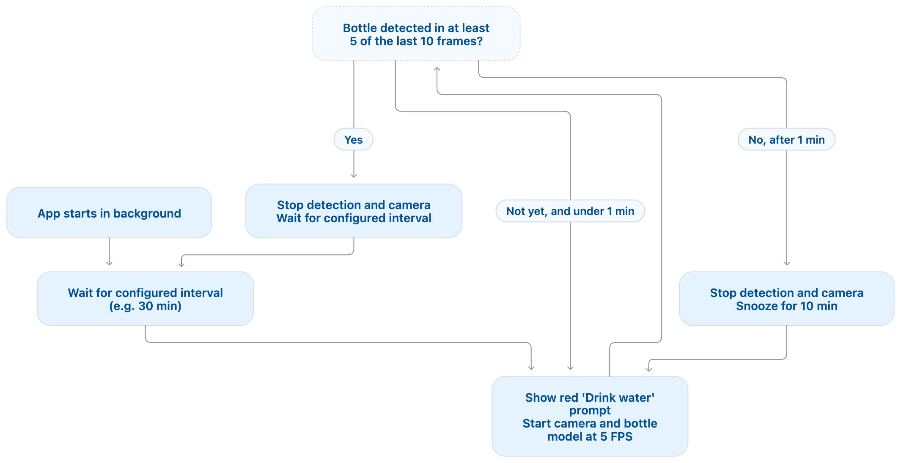

# JalLijiye

Hydration reminder app for macOS that waits in the background, shows a menu bar prompt when a reminder is due, and runs only the custom bottle detector during active checks.

## Features

- Hides its menu bar item while waiting; shows the prompt and controls during a reminder or snooze, until hydration is recorded.
- Waits for the configured reminder interval before opening the camera or loading the ML runtime.
- Starts a fresh bottle-check window when macOS wakes from system sleep.
- Runs scheduled bottle checks only on WFH weekdays from the six-week team rotation; days listing Data-Tech stay idle.
- Shows a red `Drink water` prompt and runs the bottle model at the configured frame rate for up to 60 seconds.
- Treats bottle detection in at least 5 of the last 10 sampled frames as a completed reminder, then waits for the regular interval.
- If the threshold is not met within 60 seconds, stops detection, keeps the red prompt visible, and retries after a 10-minute snooze.
- Prefers Apple MPS inference when available and falls back to CPU if MPS inference fails.

## High-Level Design



For the previous continuous person-and-bottle detection architecture, see the [legacy HLD](docs/legacy-hld.md).

## Setup

```bash
cd /Users/prateek/Downloads/_Projects/Personal/codex/jalLijiye
python3 -m venv .venv
source .venv/bin/activate
pip install --no-build-isolation -e '.[dev]'
```

## Run

```bash
cd /Users/prateek/Downloads/_Projects/Personal/codex/jalLijiye
source .venv/bin/activate
python -m app.main
```

Grant Camera permission when the first scheduled bottle check opens the camera.

## Build macOS App

Build a proper `.app` bundle for menu bar startup on macOS:

```bash
cd /Users/prateek/Downloads/_Projects/Personal/codex/jalLijiye
chmod +x scripts/build_macos_app.sh
./scripts/build_macos_app.sh
```

Expected output:
- `dist/JalLijiye.app`

## Config

The WFH calendar follows the supplied Week 43–50 table as a repeating six-week
cycle, anchored at ISO Week 43 of 2026 as Mod Week 5. Checks run on Tuesdays
and Thursdays for Mod Weeks 1 and 3, only Tuesday for Mod Week 4, and Monday,
Wednesday, and Friday for Mod Weeks 2, 5, and 6. The calendar uses the Mac's
local date and time. On non-WFH days the detector stays stopped, and checks
resume at midnight on the next WFH day.

Edit `/Users/prateek/Downloads/_Projects/Personal/codex/jalLijiye/config/defaults.yaml`.

Key values in `config/defaults.yaml`:

- `reminder_interval_minutes: 30.0`
- `detection_window_seconds: 60.0`
- `detection_snooze_minutes: 10.0`
- `fps: 1` (current low-resource test setting)
- `bottle_detection_window_frames: 10`
- `bottle_detection_threshold: 0.5`
- `bottle_model_path: models/bottle_checkered/weights/best.mlpackage` (checkered-bottle YOLOv8n Core ML FP16 export, 640×640)
- `bottle_class_id: 0`
- `bottle_confidence: 0.25` (temporary test threshold for the checkered-bottle model)

## Fast Bottle Training Workflow

### 1) Collect videos

Put your webcam videos in:
- `data/raw_videos/`

### 2) Extract frames

```bash
source .venv/bin/activate
python scripts/extract_frames.py --input-dir data/raw_videos --output-dir data/bottle/images/raw --sample-every-seconds 1.0
```

### 3) Annotate

- Annotate only bottle boxes.
- Save YOLO `.txt` labels in `data/bottle/labels/raw/`.
- Class id mapping: `0 -> my_bottle`.

### 4) Split dataset

```bash
source .venv/bin/activate
python scripts/split_dataset.py --images-raw data/bottle/images/raw --labels-raw data/bottle/labels/raw --out-root data/bottle --train-ratio 0.8
```

### 5) Train + validate

```bash
bash scripts/train_bottle_model.sh
```

Expected output model:
- `models/bottle_v1/weights/best.pt`

## Tests

```bash
source .venv/bin/activate
pytest -q
```

## Launch at Login (Recommended)

Use the macOS autostart script.

Preferred flow:
- build `dist/JalLijiye.app`
- autostart launches the app bundle at login

Fallback flow:
- if the app bundle does not exist yet, the script falls back to the NoSlouchBench-style hidden Terminal runner

Install and start:

```bash
cd /Users/prateek/Downloads/_Projects/Personal/codex/jalLijiye
chmod +x scripts/autostart_macos.sh
./scripts/autostart_macos.sh install
```

Check status:

```bash
./scripts/autostart_macos.sh status
```

Stop:

```bash
./scripts/autostart_macos.sh stop
```

Uninstall:

```bash
./scripts/autostart_macos.sh uninstall
```

## Resource Optimizations

The scheduled bottle-only measurements are listed first. The later Activity Monitor and isolated-model measurements are historical observations from the previous continuous person-and-bottle detection flow.

#### Scheduled bottle-only flow

Resource observations on 2026-10-20 for the scheduled bottle-only flow:

| Configuration | CPU (% of one core) | GPU | Real memory | Measurement notes |
| --- | ---: | ---: | ---: | --- |
| 30-second reminder interval, 1 FPS bottle checks | 4–11% (reported range) | 0–2% | 70–320 MB (reported range) | User-reported CPU, GPU, and RAM ranges during the next test. |
| 30-second reminder interval, 1 FPS Core ML bottle checks | 0.2–12% (reported range) | 0–0.2% (reported range) | 150–250 MB (reported range) | User-reported CPU, GPU, and RAM observations with the 640×640 FP16 Core ML model selected. |
| 30-second reminder interval, 1 FPS INT8 Core ML bottle checks | 0.2–11.5% | 0–0.3% | 72–96 MB at startup; 305–419 MB during checks | Activity Monitor point-in-time samples of Python PID 10074 over about 2 minutes. The startup samples preceded the higher-memory check samples; these are observed ranges, not averages or process high-water marks. |
| 30-second reminder interval, 1 FPS 320×320 FP16 Core ML bottle checks | 0.2–10.2% | 0–0.5% | 329.6–353.1 MB | Two Activity Monitor samples of Python PID 12659, about 30 seconds apart. The process was absent in the next sample; these are point-in-time observations, not averages or a high-water mark. |
| 30-second reminder interval, 5 FPS bottle checks | 3.7–15.0% | 0–5.2% | 62.6–319.2 MB | Seven point-in-time samples over approximately 2.5 minutes; resource use varied as checks started and stopped. These are observed ranges, not averages or process high-water marks. |

The 5 FPS run's Activity Monitor GPU percentage was 0% in four samples and reached 5.2% in one sample; the other two samples were 3.6% and 4.0%.

#### Checkered-bottle model comparison

On 2026-10-20, the custom bottle detector was trained separately with YOLOv8n and YOLO26n using the same 92-frame dataset annotated with MLX SAM 3. The split was grouped by time to reduce adjacent-frame leakage: 60 train, 16 validation, and 16 test frames. Training used 640×640 images, batch size 4, MPS, and seed 42. YOLOv8n trained for 15 epochs (best epoch 8); the initial YOLO26n run stopped after 12 epochs due to early stopping (best epoch 5). On 2026-10-21, YOLO26n was retrained with the same settings and early stopping disabled (`patience=0`); it completed all 30 epochs, with the best validation checkpoint at epoch 24.

| Model | Test precision | Test recall | Test mAP50 | Test mAP50–95 | Isolated mean inference | CPU (% of one core) | Peak RSS | Positive test frames detected at confidence 0.25 |
| --- | ---: | ---: | ---: | ---: | ---: | ---: | ---: | ---: |
| Checkered YOLOv8n | 1.00 | 1.00 | 0.995 | 0.799 | 22.315 ms/frame | 77.5% | 538.4 MB | 14/14 |
| Checkered YOLO26n | 0.00 | 0.00 | 0.000 | 0.000 | 23.008 ms/frame | 96.8% | 573.6 MB | 0/14 |
| Checkered YOLO26n, retrained for 30 epochs | 0.571 | 0.857 | 0.736 | 0.567 | 23.430 ms/frame | 95.4% | 575.4 MB | 11/14 |

Isolated resource profiling used MPS and ran the same 16 test images per model; its CPU and RSS readings are for separate profiling processes, not the whole app. At confidence thresholds 0.25 / 0.50 / 0.80, the retrained YOLO26n detected 11 / 5 / 2 of 14 positive frames; YOLOv8n detected 14 / 10 / 4. Neither model fired on the two negative frames at these thresholds. The saved YOLO26n checkpoint is `models/checkered_yolo26n_no_early_stop/weights/best.pt`; its training run and test results are under `runs/detect/checkered_bottle_comparison/yolo26n_batch4_no_early_stop_mps/`. The app is configured to use the 640×640 FP16 Core ML export at `models/bottle_checkered/weights/best.mlpackage`, converted from the YOLOv8n checkpoint. Confidence is temporarily set to 0.25 based on the `.pt` test results. Package-specific accuracy and resource measurements are still pending; the isolated CPU/RSS/inference figures above were measured on the `.pt` models with MPS, not on these Core ML exports. The original test contains 16 frames from one short clip in one setting, including only two negative frames, so these results are preliminary and do not establish performance across bottles, backgrounds, or lighting.

#### Bottle model backend comparison

On 2026-10-20, the FP16 Core ML export was compared with the PyTorch `.pt` model using the same 132 measured frames. The original live-capture frames were no longer available, so this replay used 132 frames sampled at approximately 5 FPS from the first 30 seconds of `data/raw_video/drinking_20260228_170214.mp4`. Each run used 5 warm-up frames before measurement, confidence 0.80, and bottle class 0.

| Model/backend | Compute device | Mean inference time | CPU time (132 frames) | CPU (% of one core) | RSS after measurement | Peak process RSS | Frames with bottle detected |
| --- | --- | ---: | ---: | ---: | ---: | ---: | ---: |
| PyTorch `.pt` | MPS | 24.8 ms/frame | 2.26 s | 69.1% | 492.4 MB | 494.5 MB | 92/132 |
| FP16 Core ML `.mlpackage` | Core ML default compute units | 21.5 ms/frame | 3.02 s | 106.4% | 346.5 MB | 372.9 MB | 91/132 |

The backends agreed on bottle presence for 131 of 132 frames (99.2%). In this replay, Core ML was about 13% faster and used about 30% less RSS after measurement, while process CPU time was about 34% higher. These are isolated inference-process measurements, not full-app measurements; Core ML's GPU usage was not recorded separately. Those Core ML results are for the 640×640 FP16 package at `models/bottle_v3/weights/best.mlpackage`. The INT8 and 320×320 FP16 full-app observations are listed in the scheduled-flow table above. The 320×320 FP16 detection quality still needs to be measured. The `.pt` weights remain available at `models/bottle_v3/weights/best.pt`.

The original 640×640 `.mlpackage` stores its model weights as Core ML `FLOAT16`. The INT8 package uses symmetric, per-channel 8-bit weight quantization. Its full-app resource readings appear in the scheduled-flow table; they do not by themselves establish that INT8 caused the higher RAM readings. Core ML keeps inference computations in floating point for this weight-only quantization, and the app still loads its camera and Python inference runtime. The 320×320 experimental package was exported from the `.pt` weights with `imgsz=320` and `half=True`; its model input is 320×320 and its weights are FP16. The earlier FP32 description was incorrect: the original package was exported as an ML Program, whose conversion used FP16 weights by default.

Activity Monitor observations on 2026-10-20 while camera inference was active on an Apple M1 MacBook Air (macOS 26.3, Python 3.12.6):

| Inference backend | Debug window | CPU (% of one core) | GPU | Real memory | Measurement notes |
| --- | --- | ---: | ---: | ---: | --- |
| CPU | On (`show_debug_window: true`) | 138–149% | Not recorded | 214–218 MB | Point-in-time samples during a drinking-action attempt. |
| CPU | Off (`show_debug_window: false`) | 131–136% | Not recorded | 244–306 MB | Two early samples about 20 seconds apart; memory fell between them and had not settled. |
| MPS | On (`show_debug_window: true`) | 69.7% | 21.6% | 190.3 MB | One Activity Monitor sample during an active camera inference run (Python PID 58140). |

These are preliminary samples from separate runs, not controlled averages or peaks. They do not establish a memory reduction from disabling the debug window or a controlled performance improvement from MPS. CPU readings above 100% mean the process used more than one core. Activity Monitor did not confirm whether the drinking event was detected.

### Isolated per-model profile

On 2026-10-20, the person and bottle models were profiled in separate MPS processes using the same 137 camera frames. Each model had 5 warm-up inferences followed by 132 measured inferences. CPU and inference percentages below are each model's share of the two isolated runs.

| Model | Device | Mean inference time | CPU time per inference | Mean CPU (% of one core) | CPU time share | Inference time share |
| --- | --- | ---: | ---: | ---: | ---: | ---: |
| Person (`yolov8n.pt`) | MPS | 16.5 ms | 8.5 ms | 51.3% | 52.8% | 56.2% |
| Bottle (custom model) | MPS | 12.9 ms | 7.6 ms | 59.0% | 47.2% | 43.8% |

| Model | RSS after imports | RSS after model load | RSS after warm-up | RSS after measurement | Estimated model-load RSS increase | Peak process RSS |
| --- | ---: | ---: | ---: | ---: | ---: | ---: |
| Person (`yolov8n.pt`) | 309.5 MB | 321.1 MB | 117.3 MB | 99.8 MB | 11.6 MB | 429.8 MB |
| Bottle (custom model) | 316.4 MB | 327.5 MB | 409.0 MB | 378.3 MB | 11.2 MB | 457.3 MB |

These are isolated model runs rather than the full app. CPU time is measured around synchronized inference calls; mean CPU is process CPU time divided by inference wall time, expressed as a percentage of one core. RAM includes Python, PyTorch, Ultralytics, and model allocations. The estimated model-load RSS increase is the difference between current RSS after imports and after loading the model, so it is approximate. Current-RSS snapshots varied substantially across checkpoints; peak process RSS is the high-water mark and is more useful for comparing the two runs. The results show a near-even CPU-time split, while the bottle run had a higher peak process RSS.
