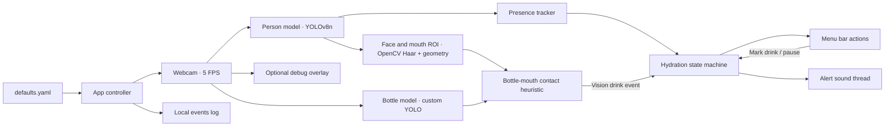

# JalLijiye — Legacy High-Level Design

This document describes the previous continuous person-and-bottle detection flow. The current scheduled bottle-only design is documented in the [README](../README.md#high-level-design).

JalLijiye ran as a macOS menu bar app with a background camera/detection thread. It continuously sampled webcam frames, combined person, face/mouth, and bottle signals to infer drinking, and used presence and hydration state to control reminders.

## Main components

| Component | Role |
| --- | --- |
| Controller | Loaded configuration, started and stopped app threads, connected detector output to hydration state, and handled manual actions. |
| Vision detector | Opened the webcam, sampled frames at up to 5 FPS, and ran person detection followed by custom bottle detection. It selected MPS when available and fell back to CPU if MPS inference failed. |
| Face and mouth locator | Used OpenCV's Haar face detector and estimated a mouth region from the face box. This was a lightweight heuristic, not a separate face model. |
| Drink heuristic | Checked bottle overlap or proximity to the expanded mouth region across frames. It required about 1 second of contact within a 5-second window and applied a cooldown before another event. |
| Presence tracker | Smoothed person detections, requiring 3 positive signals among the last 5 frames. If the person remained absent for 10 seconds, hydration tracking paused. |
| Hydration state machine | Tracked time since the last drink, presence, manual pause, and alert mode. A drink event reset the alert timer. |
| Menu bar UI | Showed hydration progress and a countdown; offered **Mark Drink Now**, **Pause 30m**, and **Quit**. |
| Alerter | Played a sound every 30 seconds during the initial alert period, then more frequently after the escalation period. |
| Debug overlay | Optionally displayed person, face, mouth, and bottle boxes plus heuristic status. It was enabled by default in the previous configuration. |

## Previous runtime flow

1. The controller loaded configuration and started the camera, detector thread, alert thread, and menu bar.
2. For each sampled camera frame, the detector ran the person and custom bottle models sequentially, then estimated the face and mouth region.
3. Presence and bottle-mouth contact signals were sent to the state machine. A confirmed vision event or manual **Mark Drink Now** action reset the timer.
4. When the alert interval elapsed, the state machine entered an escalating alert mode. Away status and manual pause suppressed alerts.
5. The menu bar refreshed the visible status, and the alert worker handled sound independently.

Most runtime state, including hydration count and last drink time, was held in memory and reset when the app restarted. Events were logged locally.
